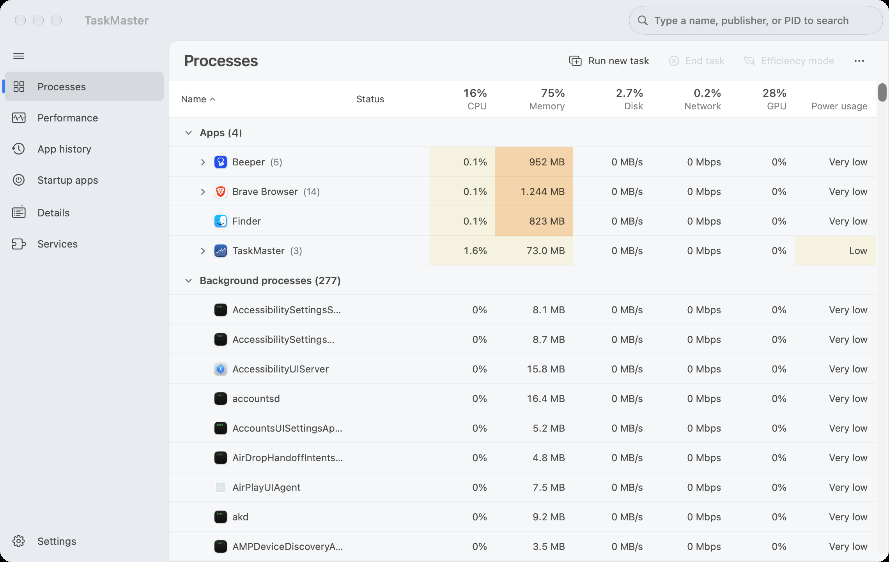
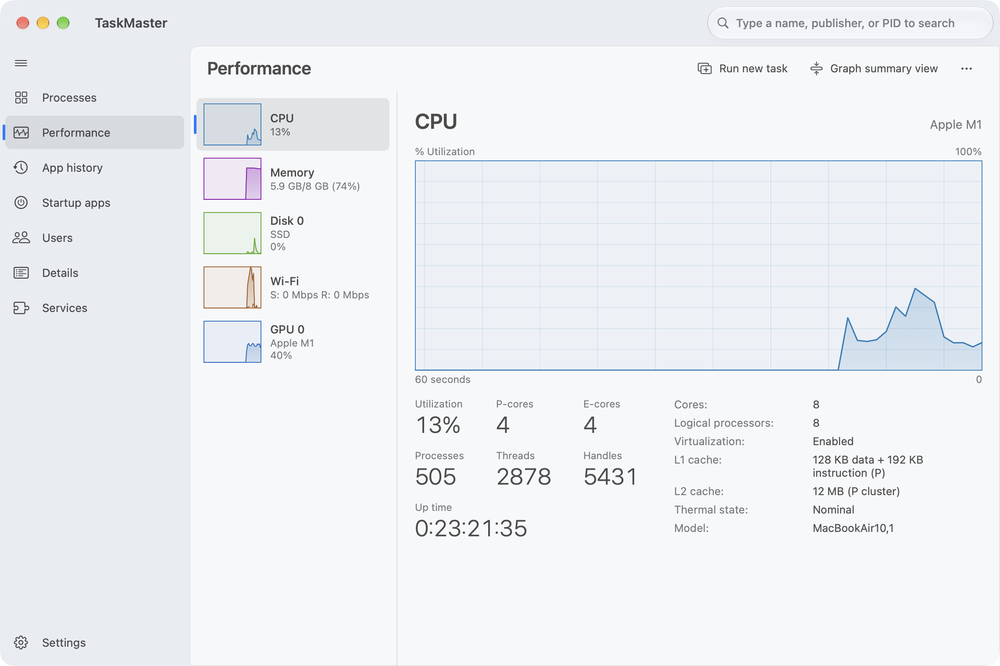
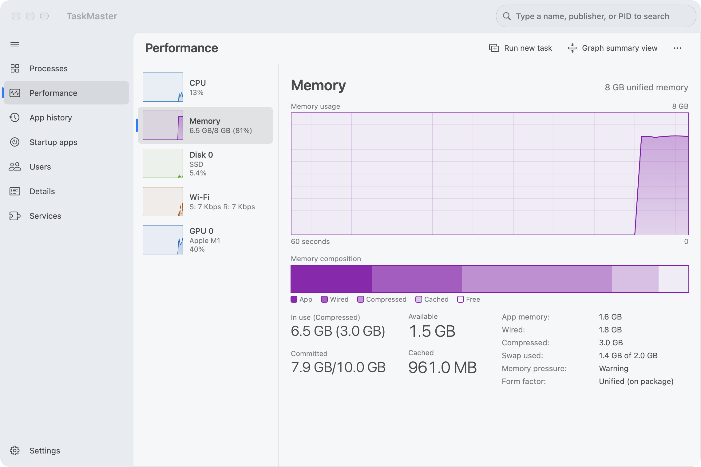
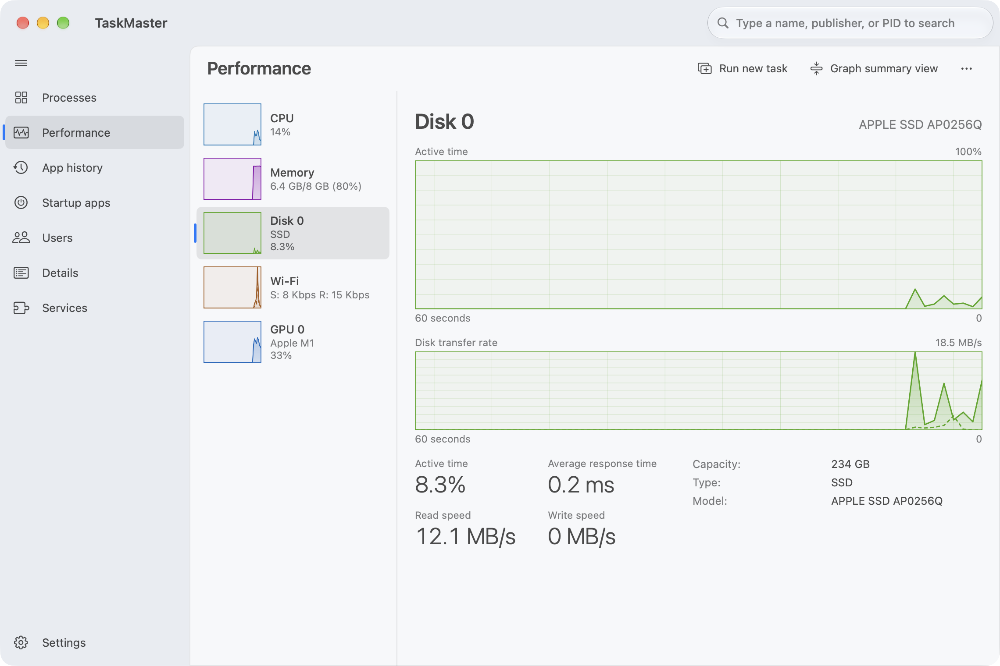
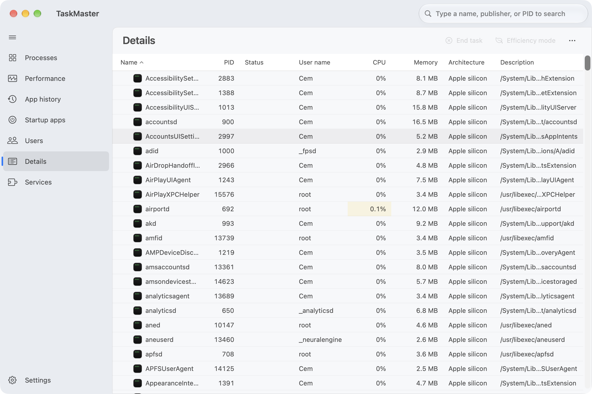
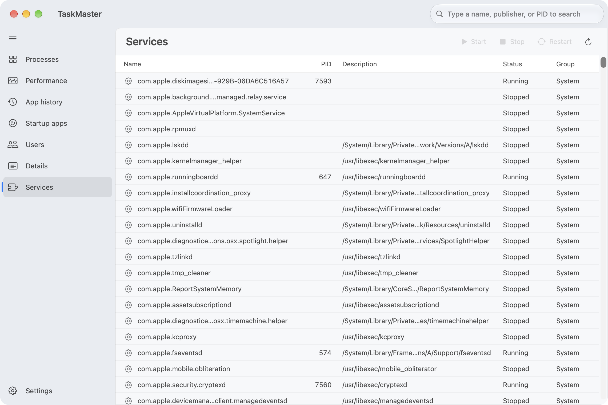
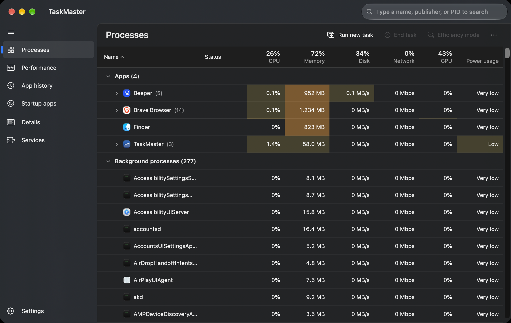

# TaskMaster

A native macOS take on the **Windows 11 Task Manager** — same layout, same pages, same heat-mapped tables and
live performance graphs, built with SwiftUI for Apple silicon.



## Features

| Windows 11 Task Manager | TaskMaster |
| --- | --- |
| **Processes** | Apps / Background / macOS processes, expandable app groups, heat-mapped CPU · Memory · Disk · Network · GPU · Power columns, End task, Efficiency mode, Run new task |
| **Performance** | CPU (overall or per-core), Memory (with composition bar), Disk, Wi-Fi/Ethernet, GPU — 60-second live graphs, graph summary view |
| **App history** | Cumulative CPU time, network and disk I/O per app, persisted across launches |
| **Startup apps** | Launch agents/daemons and login items with Enable / Disable and startup impact |
| **Users** | Per-account resource usage with the process tree underneath |
| **Details** | Flat process list with selectable columns, End process tree, Set priority, Sample process, Go to service |
| **Services** | launchd services with Start / Stop / Restart |
| **Settings** | Default page, update speed (High / Normal / Low / Paused), theme, always on top, and more |

Also: search box (name, path or PID), collapsible navigation rail, light/dark themes, keyboard navigation
(↑ ↓ ← → Return, held keys repeat; ⌘F then Return jumps from search to the first match), context menus, Properties sheet, and menu-bar commands (⌘F search, ⌘N run task,
⌘⌫ end task, ⌘R refresh, ⌘1–7 switch pages).

| Performance | Memory |
| --- | --- |
|  |  |

| Disk | Details |
| --- | --- |
|  |  |

| Services | Dark mode |
| --- | --- |
|  |  |

## Requirements

- macOS 27 or later, Apple silicon (arm64)
- Xcode 27 / Swift 6.4 toolchain to build from source

## Install

Download `TaskMaster.dmg` from the [Releases](../../releases) page, open it and drag **TaskMaster** to
**Applications**.

The app is only ad-hoc signed (not notarised). On first launch, right-click the app and choose **Open**, or run:

```bash
xattr -dr com.apple.quarantine /Applications/TaskMaster.app
```

## Build from source

```bash
git clone https://github.com/cembaylam/TaskMaster.git
cd TaskMaster
./scripts/build_app.sh      # builds build/TaskMaster.app
./scripts/make_dmg.sh       # optional: build/TaskMaster.dmg
```

For development, `swift build` / `swift run` also work.

## How it works

No private frameworks and no root helper. Data comes from public system interfaces:

- **Processes** — `sysctl(KERN_PROC)` for the list, `libproc` (`proc_pid_rusage`, `proc_pidinfo`) for CPU time,
  memory footprint, disk I/O and energy. Processes libproc hides from unprivileged apps are filled in from `top`.
- **CPU / Memory** — `host_processor_info`, `host_statistics64`, `sysctl` (swap, memory pressure).
- **Disk** — IOKit `IOBlockStorageDriver` statistics. **Network** — 64-bit interface counters via `NET_RT_IFLIST2`;
  per-process traffic from periodic `nettop` snapshots (about every 5 s).
- **GPU** — IOKit `IOAccelerator` performance statistics and per-client accumulated GPU time.
- **Services / startup** — `launchctl print`, launchd plists, and System Events for login items.

## Limitations

- macOS exposes no CPU clock speed on Apple silicon without root, so the CPU page shows core counts, caches and
  thermal state instead of GHz.
- App history only accumulates while TaskMaster is running.
- Wi-Fi network name needs Location permission and is not requested yet.
- Changing system services, raising process priority or ending other users' processes asks for administrator rights.

## Permissions

Startup apps asks once for **Automation** access to System Events to read your login items.

## License

[MIT](LICENSE)
